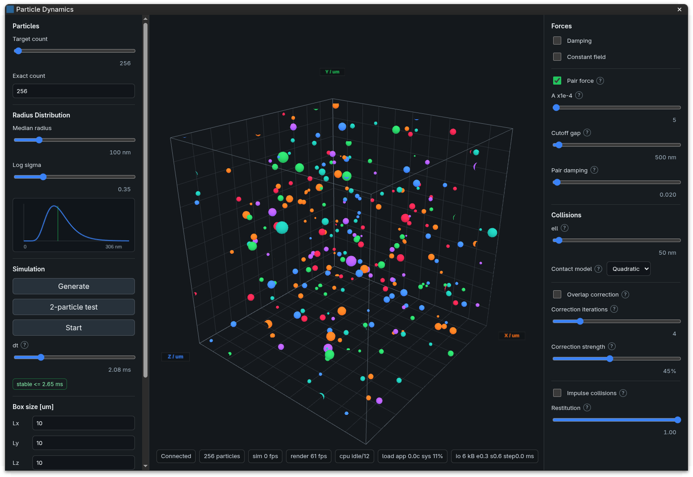

# Úvod {#sec:uvod}

<!--
Zadání kapitoly: docs/osnova.md, sekce „Kapitola 1 – Úvod“.
Doporučený rozsah: 1,5–2 strany.
-->

TODO Úvod podle zadání v `docs/osnova.md`.

<!--
==========================================================================
UKÁZKA FORMÁTU – po napsání úvodu celý tento blok smažte.
Ukazuje citaci s lokátorem, číslovanou rovnici s blokem „Kde:“, tabulku, obrázek
s popiskem a odkazy na ně. Citovaný citát je v literature/horackova2016.md.
==========================================================================
-->

Na práci přímo navazuje zjednodušená simulace agregace nanočástic realizovaná v programu Matlab [@horackova2016, s. 4], ve které byla interakce mezi dvěma kulovými částicemi popsána Hamakerovým vztahem [@horackova2016, s. 18]. Pro dvě částice stejného poloměru má tvar [@eq:hamaker-stejne-koule].

$$
U(d) = -\frac{A}{6}\left[\frac{2R^2}{(4R+d)\,d} + \frac{2R^2}{(2R+d)^2} + \ln\frac{(4R+d)\,d}{(2R+d)^2}\right]
$$ {#eq:hamaker-stejne-koule}

::: kde
- $U$ – potenciální energie interakce [J]
- $A$ – Hamakerova konstanta [J]
- $R$ – poloměr obou částic [m]
- $d$ – vzdálenost povrchů částic [m]
:::

Volba technologií v kapitole 4 se rozhoduje ve třech osách, které shrnuje [@tbl:osy].

| Osa rozhodování | Co se v ní volí |
|-----------------|-----------------|
| Výpočetní jádro | jazyk a způsob paralelizace výpočtu sil |
| Vizualizace a GUI | vykreslování 3D scény a ovládání simulace |
| Přenos dat | cesta poloh částic z výpočtu do vykreslování |

: Osy volby technologií {#tbl:osy}

Vizuální podobu startovního prototypu ukazuje [@fig:starter].

{#fig:starter width=80%}

<!-- KONEC UKÁZKY -->
